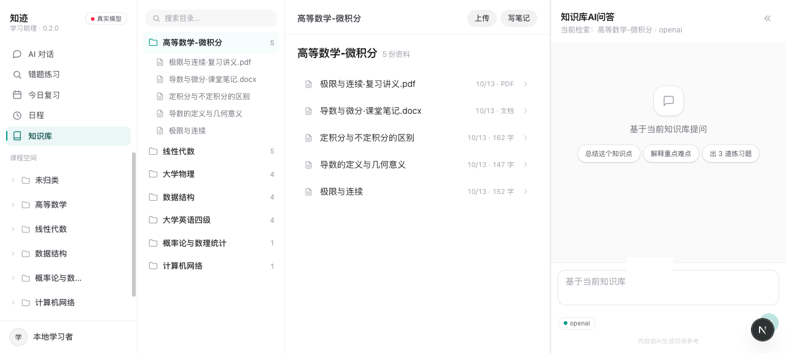
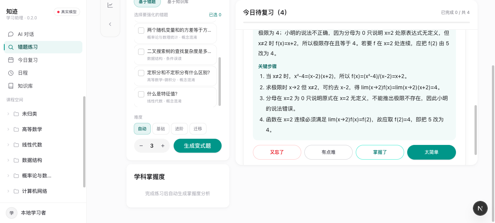

<div align="center">

# 知迹 ZhiJi

**把学习资料变成题，再把题变成复习计划。**

面向大学生的个人学习助理 —— 传进讲义和错题照片，它帮你整理出题、排好复习。

`LangGraph` 编排 · `FastAPI` + `SQLite` · `Next.js 16`

</div>

---

## 它做什么

|  |  |
| --- | --- |
| **整理资料** | 讲义、课件、笔记、拍照的板书传进来，按学科分好。PDF 能翻到第几页，图片由多模态模型转成文字。 |
| **自动出题** | 按你传进来的资料出题。上次做错的方向，会多出几道变式题；难度按掌握度自动分档。 |
| **结合知识库复习** | 今天该练哪几题，按掌握度和到期时间排好。复习时能翻回原文的那一页。 |

> 一句话产品定义：**整理学习资料 ＋ 自动出错题 ＋ 结合知识库复习**。
> 后文的架构、权限、评测都是支撑这三件事的做法，不是另一个故事。

<details>
<summary><b>为什么不是"又一个 AI 聊天框"</b></summary>

学习是一个连续的过程，但多数工具是一次性的：资料被存下、答案被说过、错题被标过，
都没变成下次还能用的东西。

知迹把一次学习回合做成一张**可恢复、可拦截、可度量**的状态图 —— 断了能接着跑，
越权写不进去，改动有没有让效果变差由固定考卷判定。

</details>

---

## 界面

| 知识库 | 练习 |
| --- | --- |
|  |  |

---

## 快速开始

需要 **Python 3.12+** 和 [uv](https://docs.astral.sh/uv/)。**默认 Mock 模型，零 API 消耗、零成本。**

```bash
git clone <repo-url> && cd StudyGraph
uv sync
uv run zhiji "帮我算一下 7 * 9"
```

预期输出：

```text
（模拟模型）根据工具返回的结果：63
```

这条命令背后：意图被识别为「计算」→ 路由到计算子智能体 → 模型请求调用计算器工具
（参数 `7 * 9`）→ 工具返回 `63` → 模型据此作答。**全程不联网、不花额度。**

### 跑起 Web 界面

```bash
cd frontend && npm install && cd ..
./scripts/dev.sh                    # 后端 8011 + 前端 3000
```

打开 <http://localhost:3000>。想直接看到有内容的界面，先播种演示数据：

```bash
uv run zhiji-demo --reset           # 5 个学科库 · 24 份自编资料 · 5 门课程 · 7 条典型误区
```

> ⚠️ `--reset` 会**清空并重建**数据库。真实使用前请先备份（见 [使用指南](docs/使用指南.md#数据与备份)）。

### 走一遍完整闭环

```bash
# 1. 沉淀一条笔记 —— 写操作会先请求确认（--yes 可自动同意）
uv run zhiji "记住：我在准备月底的微积分测验" --yes

# 2. 检索刚沉淀的内容
uv run zhiji "我的笔记里怎么讲微积分测验的？"
```

---

## 能力

### 对话与教学

- **判意图再作答** —— 六类意图（讲解 / 练习 / 进度 / 检索 / 计算 / 闲聊）路由到不同子智能体
- **回合画成状态图** —— `route → plan → agent ⇄ tools`，循环与分支都写在明面上
- **私教人格** —— 结论先行、分层表达、结尾给下一步；讲解深度随该学科掌握度变化
- **看得见的思考过程** —— SSE 逐条推送「理解问题 / 制定计划 / 工具调用」，回答带出处
- **课程空间隔离** —— 会话与长期记忆按课程分组，新建对话必选课程
- **三路上传附件** —— ＋菜单 / 粘贴 / 拖入，PDF·Word·PPT·图片；图片走视觉转写入库

### 知识库与检索

- **四路召回** —— 字面 FTS + 同义/中英扩写 + 两字词 LIKE + 向量语义，RRF 加权融合后词面精排
- **智能选库** —— 模型按问题挑相关库，编造库名过滤、判断不出回落全库
- **原样秒传 + 懒解析** —— 二进制文件先落盘不解析，用到时才建索引；PDF/PPT 逐页切块带页码出处
- **Obsidian 式阅读** —— 目录树 + 正文 + AI 助手/大纲双栏，划词提问、大纲滚动联动

### 学习闭环

- **错题带错误类型** —— 概念混淆 / 步骤遗漏 / 条件误读 / 计算失误 / 表述不清，可按类型聚合筛选
- **按错因出变式题** —— 一条误区只出一道题，不会重复刷；模型写题失败自动回退模板，绝不抛异常
- **按需生成详解** —— 参考答案 + 关键步骤，懒生成并落库缓存（首次 3.7s，之后 0.02s）
- **间隔重复排期** —— 四档自评映射掌握度增减与下次间隔，again 立即 / hard 1 天 / good 3 天 / easy 7 天
- **今日复习** —— 到期题、薄弱学科、近期误区、活跃度热力图、学习周报
- **日程时间轴** —— 想法先进收件箱，再一键排进时间轴；排期是确定性算法，零模型调用

### 工程保障

- **工具最小权限（双层）** —— schema 层不给模型看禁用工具，执行层再拦一次；MCP 工具默认关闭
- **写入前先确认** —— 沉淀笔记、写文件先 `interrupt()` 请求人工确认，确认后才落库
- **评测门禁** —— 检索 35 题 + 意图 15 句，各有基线 JSON，掉出容差命令返回非零，可进 CI
- **回合 trace** —— 一次会话能读成一棵诊断树，归因到检索 / 工具 / 模型层
- **成本可控** —— token 记账 + 当日预算，超限阻止真实调用；按意图复杂度选模型档位
- **护栏** —— 输入拦越界与提示词注入，输出拦空回答与系统提示词泄漏
- **MCP 客户端** —— 自写最小 stdio JSON-RPC，启动外部 server、发现并注册工具
- **联网搜索** —— 一次给 2–4 个不同角度的查询词多路召回，搜回内容一律标注为外部资料

<details>
<summary><b>完整能力清单（59 项，含实现细节）</b></summary>

| 域 | 能力 |
| --- | --- |
| 对话 | 意图路由（六类）· 显式状态图 · 私教人格与掌握度自适应讲解 · 过程流面板与单行活动模式 · 收束条四动作 · 会话自动起标题 · 课程空间隔离 · 隐藏兜底空间「未归类」· 三路附件上传 · Markdown 渲染（表格/公式/代码块）· 提问热力图 |
| 知识库 | 四路混合召回 + RRF 加权 + 词面精排 · 智能选库与回落全库 · 同义/中英扩写词表（可外部追加）· 原样秒传 + 懒解析 · markitdown 逐页切块带页码出处 · 魔数校验挡损坏文件 · 图片视觉转写成 Markdown · 智能沉淀（模型提炼入库）· 三栏阅读页 · 划词提问 · 大纲滚动联动 · 全量 CRUD + 右键菜单 |
| 学习 | 错题记录（学科 + 错误类型）· 智能分类筛选 · 变式题派生 · 难度三档自动分档 · 流式出题进度 · 牌堆复习 · 详解懒生成缓存 · 四档自评 · 掌握度增减 · 间隔重复排期 · 今日复习规划 · 学习周报 · 活跃度热力图 · 长期记忆（按课程隔离）· 收件箱 + 时间轴 + 迷你日历 |
| 工程 | 工具双层权限 · MCP 工具授权 · HITL 写入确认 · 输入/输出护栏 · 工具超时与退避重试 · 工具并发执行 · 上下文压缩（抽取式摘要）· 规划 plan-and-execute · 模型路由 · token 记账与日预算 · 回合 trace 五层归因 · 断点持久化与检查点级联清理 · SSE 流式 · 双模型适配 |

</details>

---

## 架构

代码按**依赖只朝内**分层，外部技术可替换而不动业务规则：

| 层 | 目录 | 允许依赖 | 内容 |
| --- | --- | --- | --- |
| 领域 Domain | `domain/` | 仅标准库 | 间隔重复、掌握度、出题规则、RRF 融合、记忆抽取、笔记风格 |
| 应用 Application | `application/` | 领域 + 端口 | 用例编排、**端口 Protocol**、LangGraph 图与工具 |
| 基础设施 Infrastructure | `infrastructure/` | 应用 / 领域 | SQLite 仓储、Embedding、LLM、文件解析与视觉转写 |
| 接口 Interfaces | `interfaces/` | 全部 | FastAPI、CLI（**组合根**） |

应用层只依赖 `application/ports.py` 里的 **Protocol**，不 import 任何具体实现 ——
换数据库、换模型、换检索都不用改业务代码。领域层是纯逻辑，测它不用起数据库、不联网。

一次回合的状态图：

```text
START → route → plan → agent ⇄ tools → END
       意图路由  规划   模型+工具循环
```

`tools` 节点执行层做权限拦截与 HITL 中断。设计取舍见 [架构设计](docs/架构设计.md)。

---

## 测试与评测

```bash
uv run pytest -q --basetemp=/tmp/sg-pytest    # 284 passed，全 Mock 零 API 消耗
uv run ruff check src tests scripts
cd frontend && npx tsc --noEmit && npx eslint src && cd ..
```

评测门禁（有基线时掉超过容差 → 退出码 1，可直接进 CI）：

```bash
uv run zhiji-eval retrieval --dataset evals/datasets/retrieval.json \
  --baseline evals/baselines/retrieval.json
uv run zhiji-eval intent --dataset evals/datasets/intent.json \
  --baseline evals/baselines/intent.json

uv run zhiji-trace --thread <thread_id>       # 把一次会话读成诊断树
```

| 指标 | 当前基线 |
| --- | --- |
| 检索（35 题 / 21 篇语料） | Hit@3 = 0.9714 · MRR = 0.9714 |
| 检索（接真实向量） | 35 / 35 全中 |
| 消融：关掉词面精排 | MRR 0.9714 → **0.9571** |
| 意图分类（15 句） | 准确率 = 1.0 |
| 自动测试 | 284 passed |

每个数字的复现命令见 [评测证据包](docs/作品集/参赛/03-评测证据包.md)。

---

## 接入真实模型

任何 OpenAI 兼容平台（DeepSeek / OpenAI / …）。配置写进项目根目录 `.env`（Git 忽略，启动时自动加载）：

```bash
uv sync --extra openai
```

```bash
# .env 示例（DeepSeek-V4.1-Flash）
ZHIJI_LLM_PROVIDER=openai
ZHIJI_MODEL=deepseek-flash
ZHIJI_OPENAI_BASE_URL=https://api.deepseek.com/v1
ZHIJI_OPENAI_API_KEY=你的密钥
ZHIJI_MAX_OUTPUT_TOKENS=4096
```

> 推理型模型务必设 `ZHIJI_MAX_OUTPUT_TOKENS=4096`，否则输出会被"思考"吃光导致空回答。
> 完整环境变量清单见 [.env.example](.env.example) 与 [使用指南](docs/使用指南.md#接入真实模型)。

---

## 项目结构

```text
src/zhiji/
├── domain/            纯领域逻辑（不依赖框架 / DB）
│   ├── scheduling.py     间隔重复 + 掌握度
│   ├── quiz.py           出题规则（难度三档 / 提示词 / 模板）
│   ├── retrieval.py      切块 + RRF 融合 + 词面精排
│   ├── memory.py         长期记忆抽取
│   ├── note_style.py     Markdown 笔记写作规范
│   ├── planning.py / model_routing.py / evaluation.py / guardrails.py
├── application/       用例编排 + 端口（LangGraph 在这层）
│   ├── ports.py          对外部世界的 Protocol
│   ├── graph.py / routing.py / tools.py / state.py
│   ├── learning_service.py / schedule_service.py / library_selector.py
│   ├── question_writer.py / image_notes.py / tool_runner.py / context.py
├── infrastructure/    适配器（端口的实现）
│   ├── knowledge.py              SQLite + 四路混合检索
│   ├── learning_repository.py / chat_repository.py / schedule_repository.py
│   ├── usage_repository.py / embeddings.py / extract.py / llm.py
│   ├── mcp_client.py / mcp_bridge.py
├── interfaces/        入口（组合根）
│   ├── api.py            FastAPI + SSE（全部端点）
│   ├── cli.py / demo.py / evals.py / trace.py
frontend/          Next.js 16 界面（App Router + Tailwind + Radix）
├── src/app/           7 个路由
├── src/components/    AppShell · Chat · KnowledgeTree · Markdown
└── src/lib/api.ts     接口封装（含 SSE 解析器）
evals/             评测数据集与基线
assets/demo_materials/  演示素材（内容全部自编，不引用教材）
tests/             284 个自动测试（Mock，零 API 消耗）
scripts/           dev.sh · build_demo_materials.py · make_overview_figure.py
docs/              架构设计 / 使用指南 / 交接文档 / 参赛材料 / 插图
data/              SQLite 库 + 附件 + 备份（Git 忽略）
```

---

## 文档

| 我想… | 去看 |
| --- | --- |
| 装起来、跑起来、排查报错 | [使用指南](docs/使用指南.md) |
| 理解状态图、检索与权限、设计取舍 | [架构设计](docs/架构设计.md) |
| 查后端接口（给前端用） | [接口一览](docs/参考/API一览.md) |
| **AI 编码 Agent 入口（命令 / 硬规则 / 坑）** | [AGENTS.md](AGENTS.md) |
| 接手开发 / 交给下一个 Agent | [交接文档](docs/交接文档.md) |
| 参加竞赛：申报材料与合规文件 | [作品集/参赛/](docs/作品集/参赛/README.md) |
| 做答辩 PPT / 插图 | [答辩 PPT 交付说明](docs/作品集/参赛/知迹答辩/README.md) |
| 看版本之间改了什么 | [更新日志](CHANGELOG.md) |

---

## 当前边界

诚实说明，避免误解：

- **单用户**，无鉴权与多用户隔离
- **未做**：在线监控聚合面板、Reranker 重排、反思式自我批判、任务级成功率评测
- 上述条目在 [主张与证据核对表](docs/作品集/参赛/02-主张与证据核对表.md) 中标为「计划中」，**不以已完成口径出现**

## 授权与来源

- 演示素材（PDF / Word / PPT / 图片）**全部自编**，不引用教材扫描件或网络下载文档 ——
  逐份来源见 [来源与授权清单](docs/作品集/参赛/05-来源与授权清单.md)
- 第三方依赖与模型服务的授权说明同见该清单
